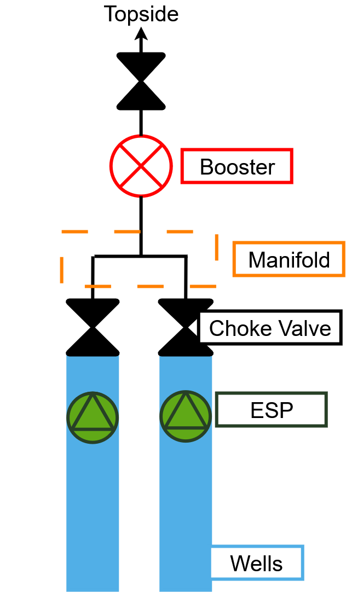
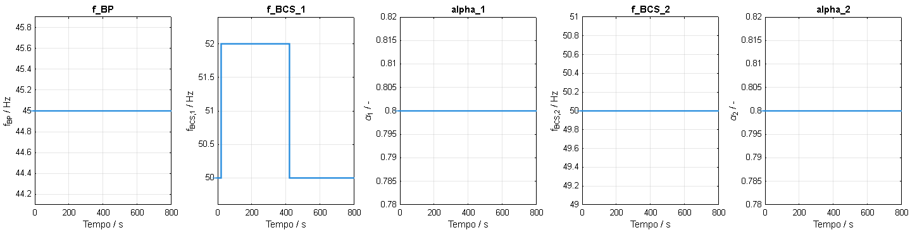
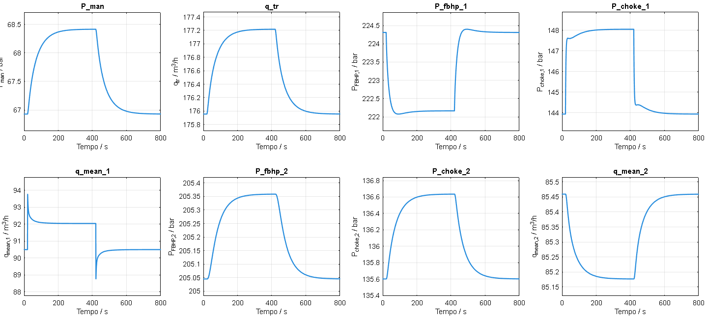
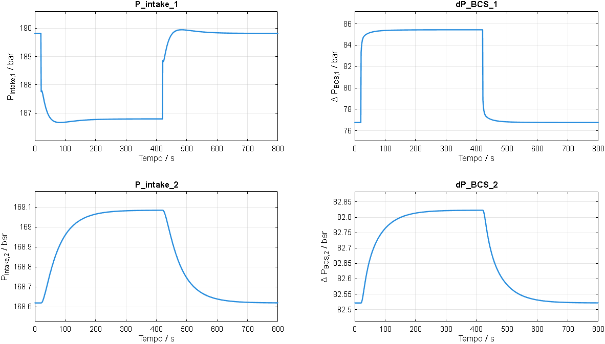
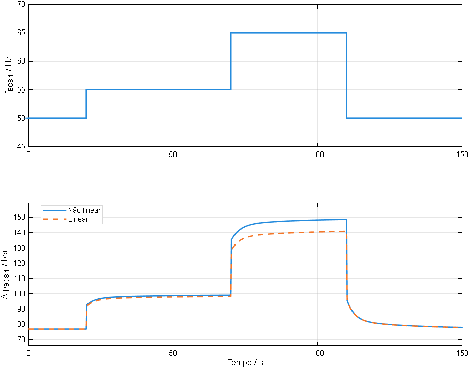
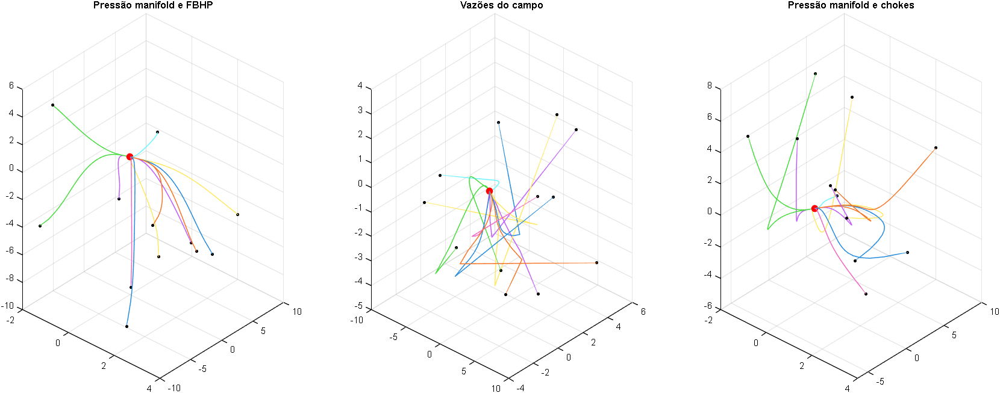
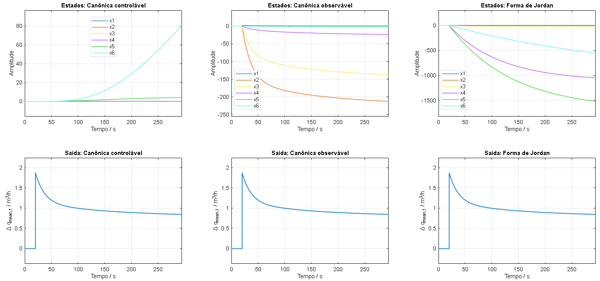
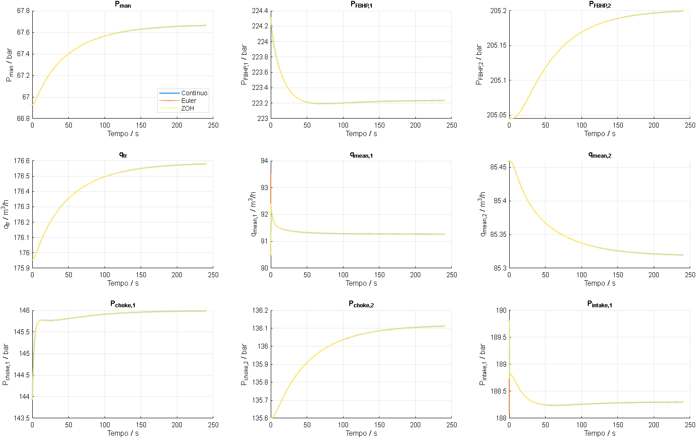

# Análise dinâmica e representação em espaço de estados de um campo de produção de petróleo operado por BCS

**Rafael Costa Coutinho e Guilherme Rocha**  
**Universidade Federal da Bahia (UFBA)** — Engenharia de Controle e Automação Industrial

[**Relatório completo em PDF**](Latex/relatorio.pdf) · [**Fonte em LaTeX**](Latex/main.tex) · [**Figuras**](Latex/figuras/)

---

## Resumo

Este trabalho apresenta a análise dinâmica de um campo de produção de petróleo composto por dois poços equipados com **Bombeio Centrífugo Submerso (BCS)**, conectados a um *manifold* comum e a uma bomba *booster*. A partir de uma adaptação do modelo fenomenológico de Rønning (2011), representado por equações diferenciais-algébricas (DAE), foram investigadas as respostas do processo a perturbações operacionais, a linearização em torno de um ponto estacionário, a estabilidade local, as formas canônicas e a discretização do modelo linearizado.

As simulações permitiram caracterizar a interação hidráulica entre os poços, identificar modos dinâmicos de diferentes escalas de tempo e comparar a representatividade das formulações linear e não linear. Também foram avaliadas realizações em espaço de estados nas formas controlável, observável e de Jordan, além das aproximações discretas pelos métodos de Euler explícito e retenção de ordem zero (ZOH).

**Palavras-chave:** bombeio centrífugo submerso; modelo fenomenológico; espaço de estados; equações diferenciais-algébricas; estabilidade; formas canônicas; discretização.

### Conteúdo

1. [Introdução](#1-introdução)
2. [Campo de produção e modelo fenomenológico](#2-campo-de-produção-e-modelo-fenomenológico)
3. [Ponto de operação e respostas dinâmicas](#3-ponto-de-operação-e-respostas-dinâmicas)
4. [Linearização em espaço de estados](#4-linearização-em-espaço-de-estados)
5. [Análise de estabilidade](#5-análise-de-estabilidade)
6. [Formas canônicas](#6-formas-canônicas)
7. [Discretização do modelo linearizado](#7-discretização-do-modelo-linearizado)
8. [Considerações finais](#8-considerações-finais)
9. [Arquivos, compilação e referência](#9-arquivos-compilação-e-referência)

---

## 1. Introdução

O Bombeio Centrífugo Submerso constitui um método de elevação artificial empregado quando a energia disponível no reservatório não permite alcançar as condições de produção desejadas. Sua aplicação é relevante em poços de elevada profundidade e em operações que demandam vazões expressivas. Entretanto, a operação de sistemas com BCS depende de restrições hidráulicas e operacionais, incluindo as pressões de fundo, as perdas de carga, o funcionamento das bombas e a regulagem das válvulas *choke*.

Em campos com múltiplos poços conectados a um *manifold*, a alteração de uma entrada operacional pode modificar as condições hidráulicas dos demais poços. Assim, a representação matemática do processo permite investigar a dinâmica conjunta do sistema sem introduzir perturbações diretamente na instalação física. A modelagem em espaço de estados é especialmente adequada nesse contexto por reunir, em uma mesma formulação, a evolução dos estados internos e a influência das entradas manipuladas.

**Objetivo:** analisar o comportamento dinâmico de um campo de dois poços operados por BCS, a partir do modelo fenomenológico não linear, e investigar a estabilidade e diferentes representações de seu modelo linearizado.

## 2. Campo de produção e modelo fenomenológico

O campo estudado possui **dois poços de produção**, cada um com uma BCS e uma válvula *choke*, interligados a um *manifold* comum. A jusante do *manifold*, uma bomba *booster* auxilia no transporte do fluido até as instalações de superfície. O acoplamento hidráulico entre os poços ocorre principalmente pela pressão do *manifold*, determinada pelas vazões recebidas e pela vazão encaminhada à linha de transporte.

<p align="center">
  
</p>
<p align="center"><sub><strong>Figura 1.</strong> Fluxograma do campo de produção de petróleo. Fonte: elaboração própria.</sub></p>

### 2.1. Representação diferencial-algébrica

O sistema é descrito por oito equações diferenciais ordinárias e quatro equações algébricas, organizadas na forma:

$$
\dot{\mathbf{x}}=f(\mathbf{x},\mathbf{z},\mathbf{u}),
\qquad
\mathbf{0}=g(\mathbf{x},\mathbf{z},\mathbf{u}).
$$

Nessa representação, $\mathbf{x}$ reúne os estados diferenciais, $\mathbf{z}$ as variáveis algébricas e $\mathbf{u}$ as entradas operacionais:

$$
\mathbf{x}=\begin{bmatrix}
 p_{\mathrm{man}} & q_{\mathrm{tr}} & p_{\mathrm{FBHP},1} & p_{c,1} & \bar q_1 &
 p_{\mathrm{FBHP},2} & p_{c,2} & \bar q_2
\end{bmatrix}^{T}
$$

$$
\mathbf{z}=\begin{bmatrix}
 p_{\mathrm{intake},1} & \Delta p_{\mathrm{BCS},1} &
 p_{\mathrm{intake},2} & \Delta p_{\mathrm{BCS},2}
\end{bmatrix}^{T}
$$

$$
\mathbf{u}=\begin{bmatrix}
 f_{\mathrm{BP}} & p_{\mathrm{topside}} &
 f_{\mathrm{BCS},1} & \alpha_1 & f_{\mathrm{BCS},2} & \alpha_2
\end{bmatrix}^{T}.
$$

As grandezas representam:

| Conjunto | Dimensão | Significado físico |
|:--|:--:|:--|
| $\mathbf{x}$ | $8$ | Pressão do *manifold*, vazão de transporte e três estados diferenciais por poço: pressão de fundo, pressão na entrada da *choke* e vazão média |
| $\mathbf{z}$ | $4$ | Pressão de entrada e incremento de pressão de cada BCS |
| $\mathbf{u}$ | $6$ | Frequência da *booster*, pressão *topside*, frequências das BCS e aberturas das duas *chokes* |

O modelo considera os balanços de massa e de quantidade de movimento, as perdas de pressão por atrito, as diferenças de altura, a resposta das válvulas e as curvas características das bombas. As **oito variáveis de estado** descrevem a dinâmica do processo; as **quatro variáveis algébricas** são determinadas pelas relações hidráulicas instantâneas.

Nas análises apresentadas, a pressão *topside* é mantida constante. Portanto, entre as seis entradas do modelo completo, **cinco são manipuladas** nas simulações de perturbação: $f_{\mathrm{BP}}$, $f_{\mathrm{BCS},1}$, $\alpha_1$, $f_{\mathrm{BCS},2}$ e $\alpha_2$.

## 3. Ponto de operação e respostas dinâmicas

### 3.1. Determinação do ponto estacionário

Para determinar o ponto de operação, foram fixadas as frequências da *booster* e das BCS em **45 Hz** e **50 Hz**, respectivamente. As aberturas das válvulas foram definidas como **0,8** e a pressão *topside* como **1 bar**. O equilíbrio foi calculado numericamente, impondo-se:

$$
 f(\mathbf{x}_{ss},\mathbf{z}_{ss},\mathbf{u}_{ss})=\mathbf{0},
 \qquad
 g(\mathbf{x}_{ss},\mathbf{z}_{ss},\mathbf{u}_{ss})=\mathbf{0}.
$$

Os valores estacionários reportados são:

| Vetor | Variável / unidade | Valor | Variável / unidade | Valor |
|:--|:--|--:|:--|--:|
| $\mathbf{x}_{ss}$ | $p_{\mathrm{man}}/\mathrm{bar}$ | 66,9278 | $q_{\mathrm{tr}}/(\mathrm{m}^3/\mathrm{h})$ | 175,9557 |
| | $p_{\mathrm{FBHP},1}/\mathrm{bar}$ | 224,3109 | $p_{c,1}/\mathrm{bar}$ | 143,9351 |
| | $\bar q_1/(\mathrm{m}^3/\mathrm{h})$ | 90,4961 | $p_{\mathrm{FBHP},2}/\mathrm{bar}$ | 205,0449 |
| | $p_{c,2}/\mathrm{bar}$ | 135,6019 | $\bar q_2/(\mathrm{m}^3/\mathrm{h})$ | 85,4595 |
| $\mathbf{z}_{ss}$ | $p_{\mathrm{intake},1}/\mathrm{bar}$ | 189,8151 | $\Delta p_{\mathrm{BCS},1}/\mathrm{bar}$ | 76,7618 |
| | $p_{\mathrm{intake},2}/\mathrm{bar}$ | 168,6196 | $\Delta p_{\mathrm{BCS},2}/\mathrm{bar}$ | 82,5215 |

Os valores permitem caracterizar uma condição de referência para avaliar as respostas dinâmicas após alterações nas entradas manipuladas.

### 3.2. Perturbações individuais nas entradas

Foram aplicados pulsos independentes às entradas manipuladas, mantendo as demais entradas nos respectivos valores nominais. As amplitudes utilizadas foram de **2 Hz** para as frequências e de **0,03** para as aberturas das válvulas *choke*. Após cada pulso, a entrada retorna ao valor de referência, permitindo observar o transitório e a recuperação do sistema.

Como exemplo, as figuras seguintes apresentam a perturbação na frequência da BCS do primeiro poço e suas consequências para as variáveis dinâmicas e algébricas.

<p align="center">
  
</p>
<p align="center"><sub><strong>Figura 2.</strong> Perturbação na frequência da BCS do poço 1, com as demais entradas mantidas nos valores nominais. Fonte: elaboração própria.</sub></p>

<p align="center">
  
</p>
<p align="center"><sub><strong>Figura 3.</strong> Respostas dos oito estados diferenciais às perturbações na BCS do primeiro poço. Fonte: elaboração própria.</sub></p>

O aumento da frequência de uma BCS modifica diretamente as condições hidráulicas de seu poço e, por meio do *manifold*, pode afetar também a vazão total e as pressões associadas ao outro poço. As trajetórias mostram, assim, a natureza multivariável e acoplada do processo. Após a retirada da perturbação, as variáveis evoluem em direção às condições de equilíbrio.

### 3.3. Comportamento das variáveis algébricas

As pressões de entrada das BCS e os incrementos de pressão correspondentes não constituem estados diferenciais adicionais. Essas grandezas são determinadas pelas restrições algébricas do modelo e acompanham as mudanças nas condições de operação.

<p align="center">
  
</p>
<p align="center"><sub><strong>Figura 4.</strong> Respostas das pressões de entrada e dos incrementos de pressão das BCS durante a perturbação no poço 1. Fonte: elaboração própria.</sub></p>

A variação das pressões algébricas evidencia tanto o efeito direto sobre a BCS perturbada quanto o acoplamento com o restante do sistema.

## 4. Linearização em espaço de estados

A linearização foi realizada por expansão de Taylor de primeira ordem em torno do ponto estacionário $(\mathbf{x}_{ss},\mathbf{z}_{ss},\mathbf{u}_{ss})$. **As variáveis com chapéu representam desvios absolutos (dimensionais), e não desvios percentuais**:

$$
\hat{\mathbf{x}}=\mathbf{x}-\mathbf{x}_{ss},\qquad
\hat{\mathbf{z}}=\mathbf{z}-\mathbf{z}_{ss},\qquad
\hat{\mathbf{u}}=\mathbf{u}-\mathbf{u}_{ss}.
$$

### 4.1. Jacobianas e eliminação das variáveis algébricas

A expansão linearizada do sistema DAE resulta em:

$$
\dot{\hat{\mathbf{x}}}=
\mathbf{F}_x\hat{\mathbf{x}}+
\mathbf{F}_z\hat{\mathbf{z}}+
\mathbf{F}_u\hat{\mathbf{u}},
$$

$$
\mathbf{0}=
\mathbf{G}_x\hat{\mathbf{x}}+
\mathbf{G}_z\hat{\mathbf{z}}+
\mathbf{G}_u\hat{\mathbf{u}},
$$

em que $\mathbf{F}_x$, $\mathbf{F}_z$, $\mathbf{F}_u$, $\mathbf{G}_x$, $\mathbf{G}_z$ e $\mathbf{G}_u$ são matrizes jacobianas avaliadas no ponto de operação.

Admitindo $\mathbf{G}_z$ não singular, as variáveis algébricas podem ser eliminadas da equação dinâmica:

$$
\hat{\mathbf{z}}=-\mathbf{G}_z^{-1}\mathbf{G}_x\hat{\mathbf{x}}
-\mathbf{G}_z^{-1}\mathbf{G}_u\hat{\mathbf{u}}.
$$

Assim, as matrizes do modelo linearizado são dadas por:

$$
\boxed{\mathbf{A}=\mathbf{F}_x-\mathbf{F}_z\mathbf{G}_z^{-1}\mathbf{G}_x}
$$

$$
\boxed{\mathbf{B}=\mathbf{F}_u-\mathbf{F}_z\mathbf{G}_z^{-1}\mathbf{G}_u}
$$

A representação resultante em espaço de estados é:

$$
\dot{\hat{\mathbf{x}}}=\mathbf{A}\hat{\mathbf{x}}+
\mathbf{B}\hat{\mathbf{u}},
\qquad
\hat{\mathbf{y}}=\mathbf{C}\hat{\mathbf{x}}.
$$

Com a pressão *topside* mantida constante, a representação utilizada nas análises apresenta $\mathbf{A}\in\mathbb{R}^{8\times8}$, $\mathbf{B}\in\mathbb{R}^{8\times5}$ e $\mathbf{C}=\mathbf{I}_8$. As quatro variáveis algébricas são recuperadas separadamente pela relação linearizada anterior.

### 4.2. Comparação entre os modelos linear e não linear

Para avaliar a representatividade local, foram consideradas perturbações na frequência $f_{\mathrm{BCS},1}$, selecionando como variável de comparação o **incremento de pressão da BCS do primeiro poço**, $\Delta p_{\mathrm{BCS},1}$.

O ensaio parte de **50 Hz** e aplica inicialmente uma perturbação pequena para **52 Hz**, permitindo avaliar o comportamento na vizinhança do ponto de linearização. Posteriormente, a frequência é elevada para **65 Hz**, condição mais distante do equilíbrio, antes de retornar ao valor nominal.

<p align="center">
  
</p>
<p align="center"><sub><strong>Figura 5.</strong> Comparação das respostas dos modelos linearizado e não linear para o incremento de pressão da BCS do poço 1. Fonte: elaboração própria.</sub></p>

As respostas apresentam maior concordância para a perturbação de pequena amplitude. Quando a entrada atinge 65 Hz, a diferença entre as curvas se torna mais evidente, condizente com a natureza **local** de um modelo obtido por linearização de primeira ordem. Assim, a precisão da aproximação depende da distância em relação ao ponto de operação.

## 5. Análise de estabilidade

A estabilidade foi avaliada pelos autovalores da matriz dinâmica $\mathbf{A}$. Para o modelo linear contínuo, a estabilidade assintótica é satisfeita quando todos os autovalores possuem parte real estritamente negativa:

$$
\mathrm{Re}(\lambda_i) < 0.
$$

Os oito autovalores obtidos no ponto de operação são:

| Autovalor | Valor / $\mathrm{s}^{-1}$ | Autovalor | Valor / $\mathrm{s}^{-1}$ |
|:--:|--:|:--:|--:|
| $\lambda_1$ | −203,1294 | $\lambda_5$ | −0,3850 |
| $\lambda_2$ | −148,9941 | $\lambda_6$ | −0,0676 |
| $\lambda_3$ | −2,4261 | $\lambda_7$ | −0,0553 |
| $\lambda_4$ | −0,4084 | $\lambda_8$ | −0,0182 |

Todos apresentam parte real negativa. A diferença entre seus módulos indica a coexistência de **modos rápidos e lentos**, característica importante da resposta dinâmica do campo.

### 5.1. Trajetórias no espaço de estados

Para complementar a análise espectral, foram consideradas **12 condições iniciais** próximas ao equilíbrio, com variações limitadas a **±5%** dos respectivos valores estacionários. As trajetórias do sistema linear homogêneo são determinadas pela solução:

$$
\hat{\mathbf{x}}(t)=e^{\mathbf{A}t}\hat{\mathbf{x}}(0).
$$

<p align="center">
  
</p>
<p align="center"><sub><strong>Figura 6.</strong> Projeções do espaço de estados para diferentes condições iniciais próximas ao equilíbrio. A origem corresponde ao desvio nulo. Fonte: elaboração própria.</sub></p>

A convergência das trajetórias para a origem é consistente com a distribuição dos autovalores no semiplano esquerdo. A conclusão é de **estabilidade assintótica do modelo linearizado e estabilidade local do equilíbrio do sistema não linear**, sob as hipóteses de regularidade aplicáveis; não constitui prova de estabilidade global.

## 6. Formas canônicas

A partir do modelo linear em espaço de estados, foi obtida a matriz de funções de transferência:

$$
\mathbf{G}(s)=\mathbf{C}(s\mathbf{I}-\mathbf{A})^{-1}\mathbf{B}.
$$

Como foram consideradas oito saídas e cinco entradas manipuladas, a matriz de transferência possui dimensão **8 × 5**, totalizando **40 funções de transferência SISO**.

Para analisar as formas canônicas, selecionou-se a relação entre a frequência da BCS do poço 1 e a vazão média correspondente:

$$
G(s)=\frac{\bar Q_1(s)}{F_{\mathrm{BCS},1}(s)}.
$$

Após a redução numérica por cancelamento de polos e zeros comuns, com tolerância de $10^{-5}$, foi obtida uma realização SISO de **sexta ordem**.

### 6.1. Forma canônica controlável

A matriz de estados da realização controlável apresenta os coeficientes do polinômio característico na primeira linha e elementos unitários na subdiagonal:

$$
\mathbf{A}_c\approx
\begin{bmatrix}
-204{,}0638 & -190{,}0854 & -55{,}9060 & -5{,}4805 & -0{,}20156 & -0{,}002169\\
1&0&0&0&0&0\\
0&1&0&0&0&0\\
0&0&1&0&0&0\\
0&0&0&1&0&0\\
0&0&0&0&1&0
\end{bmatrix}.
$$

Os vetores de entrada e de saída correspondentes são:

$$
\mathbf{B}_c=\begin{bmatrix}1&0&0&0&0&0\end{bmatrix}^{T}
$$

$$
\mathbf{C}_c\approx\begin{bmatrix}
385{,}2165 & 297{,}6027 & 70{,}6511 & 5{,}8657 & 0{,}182525 & 0{,}001676
\end{bmatrix}.
$$

### 6.2. Forma canônica observável

A forma observável foi obtida pela relação de dualidade com a realização controlável:

$$
\mathbf{A}_o=\mathbf{A}_c^{T}\approx
\begin{bmatrix}
-204{,}0638&1&0&0&0&0\\
-190{,}0854&0&1&0&0&0\\
-55{,}9060&0&0&1&0&0\\
-5{,}4805&0&0&0&1&0\\
-0{,}20156&0&0&0&0&1\\
-0{,}002169&0&0&0&0&0
\end{bmatrix}.
$$

As matrizes restantes satisfazem $\mathbf{B}_o=\mathbf{C}_c^T$ e $\mathbf{C}_o=\mathbf{B}_c^T$. A organização interna é diferente, mas a função de transferência é preservada.

### 6.3. Forma de Jordan

Para a realização reduzida analisada, os autovalores são distintos e a matriz de autovetores é inversível. Dessa forma, foi obtida uma representação aproximadamente diagonal:

$$
\mathbf{A}_J\approx
\begin{bmatrix}
-203{,}1294&0&0&0&0&0\\
0&-0{,}4084&0&0&0&0\\
0&0&-0{,}3850&0&0&0\\
0&0&0&-0{,}06755&0&0\\
0&0&0&0&-0{,}05526&0\\
0&0&0&0&0&-0{,}01819
\end{bmatrix}.
$$

A transformação de similaridade, com $\mathbf{V}$ formada pelos autovetores da matriz controlável, é definida por:

$$
\mathbf{A}_J=\mathbf{V}^{-1}\mathbf{A}_c\mathbf{V},\qquad
\mathbf{B}_J=\mathbf{V}^{-1}\mathbf{B}_c,\qquad
\mathbf{C}_J=\mathbf{C}_c\mathbf{V}.
$$

### 6.4. Comparação das realizações

As três representações foram submetidas ao mesmo **degrau unitário**, aplicado após 20 s nas simulações. Embora os estados internos assumam trajetórias e escalas distintas em cada sistema de coordenadas, as saídas correspondentes representam a mesma relação entrada–saída, salvo diferenças de precisão numérica.

<p align="center">
  
</p>
<p align="center"><sub><strong>Figura 7.</strong> Respostas dos estados e da saída nas formas controlável, observável e de Jordan, submetidas ao mesmo degrau unitário. Fonte: elaboração própria.</sub></p>

As três realizações não possuem necessariamente os mesmos estados físicos. Elas representam diferentes coordenadas internas de uma mesma dinâmica reduzida, cuja **equivalência relevante é a relação entre entrada e saída**.

## 7. Discretização do modelo linearizado

A representação linear contínua foi discretizada por **Euler explícito** e por **retenção de ordem zero (Zero-Order Hold — ZOH)**, permitindo comparar suas respostas às do modelo contínuo.

### 7.1. Euler explícito

Na aproximação de Euler, para um período de amostragem $T_s$, as matrizes discretas são:

$$
\mathbf{A}_{d,E}=\mathbf{I}+T_s\mathbf{A},\qquad
\mathbf{B}_{d,E}=T_s\mathbf{B}.
$$

### 7.2. Retenção de ordem zero — ZOH

No método ZOH, assume-se que a entrada permanece constante em cada intervalo de amostragem. A discretização exata para essa hipótese é dada por:

$$
\mathbf{A}_{d,Z}=e^{\mathbf{A}T_s},\qquad
\mathbf{B}_{d,Z}=\int_0^{T_s}e^{\mathbf{A}\tau}\mathbf{B}\,d\tau.
$$

Para ambos os métodos, a representação discreta é escrita como:

$$
\hat{\mathbf{x}}[k+1]=\mathbf{A}_d\hat{\mathbf{x}}[k]+\mathbf{B}_d\hat{\mathbf{u}}[k],
\qquad
\hat{\mathbf{y}}[k]=\mathbf{C}_d\hat{\mathbf{x}}[k].
$$

### 7.3. Escolha do período de amostragem

O período de amostragem adotado foi estabelecido com base na condição de estabilidade numérica de Euler. Para esse método, os autovalores discretos satisfazem:

$$
\lambda_{d,i}=1+T_s\lambda_i.
$$

A condição de estabilidade é $|1+T_s\lambda_i|<1$, conduzindo ao limite:

$$
T_{s,\max}=\min_{i}\frac{-2\,\mathrm{Re}(\lambda_i)}{|\lambda_i|^2},
\qquad
T_s=0{,}8\,T_{s,\max}.
$$

O autovalor mais rápido, aproximadamente $-203{,}1294\,\mathrm{s}^{-1}$, determina $T_{s,\max}\approx 0{,}009846\,\mathrm{s}$. Com uma margem de 20% em relação a esse limite, foi adotado **$T_s\approx0{,}007877\,\mathrm{s}$**.

Esse período foi escolhido para assegurar a estabilidade da aproximação numérica por Euler, não sendo necessariamente o valor ideal para uma futura aplicação de controle.

### 7.4. Comparação das respostas discretas

A comparação considerou um degrau de **+1 Hz** na frequência da BCS do primeiro poço, ao longo de aproximadamente **240 s**. Foram analisadas as respostas dos oito estados diferenciais e, adicionalmente, a pressão de entrada da BCS do poço 1, recuperada pela relação algébrica linearizada.

<p align="center">
  
</p>
<p align="center"><sub><strong>Figura 8.</strong> Comparação das respostas do modelo contínuo e dos modelos discretizados por Euler e ZOH. Fonte: elaboração própria.</sub></p>

Para o período de amostragem considerado, as respostas discretas permaneceram próximas da solução contínua. O ZOH reproduz a evolução do modelo linear nos instantes amostrados para entradas constantes entre amostras, enquanto Euler fornece uma aproximação de primeira ordem sujeita ao erro de discretização.

## 8. Considerações finais

O estudo permitiu caracterizar a dinâmica de um campo de produção de petróleo com dois poços operados por BCS, a partir de um modelo fenomenológico descrito por equações diferenciais-algébricas. Os resultados das simulações evidenciaram o **acoplamento hidráulico entre os poços** e a tendência de retorno ao equilíbrio após a retirada das perturbações.

A linearização em torno do ponto estacionário apresentou representatividade satisfatória na vizinhança da condição de operação, com diferenças mais perceptíveis para perturbações de maior amplitude. A análise dos autovalores e das trajetórias no espaço de estados indicou **estabilidade assintótica local**.

As formas canônicas controlável, observável e de Jordan apresentaram diferentes organizações dos estados internos, mantendo a relação entrada–saída da realização selecionada. Por fim, a discretização pelos métodos de Euler e ZOH permitiu estudar a dinâmica em tempo discreto e a influência do período de amostragem sobre a aproximação.

**Limites do estudo:** a estabilidade reportada é local; a comparação linear × não linear foi realizada em torno de um ponto de operação específico; e os resultados decorrem de simulações, sem validação experimental direta apresentada neste relatório. As análises constituem uma base para estudos posteriores de modelagem e controle de campos de produção operados por BCS.

## 9. Arquivos, compilação e referência

### 9.1. Estrutura esperada do repositório

Este README foi preparado para ficar **na raiz do repositório**, com o projeto do relatório na pasta `Latex/`:

```text
Repositorio/
├── README.md
└── Latex/
    ├── main.tex
    ├── relatorio.pdf
    ├── LEIA_ME.md
    └── figuras/
        ├── 20226.2model.drawio.png
        ├── sistema_entradas.png
        ├── sistema_saidas.png
        ├── sistema_algebricas.png
        ├── comparacao.png
        ├── estabilidade.png
        ├── canonicas.png
        └── discretizacao.png
```

Todas as **oito figuras** estão referenciadas por caminhos relativos, para serem exibidas diretamente no GitHub. A primeira figura foi limitada a 265 px de largura por ter formato vertical; os demais gráficos utilizam larguras proporcionais ao conteúdo do README.

### 9.2. Compilação do relatório

Para gerar o PDF a partir de `main.tex`, utilize uma distribuição LaTeX com os pacotes necessários declarados no preâmbulo.

No **Overleaf**, importe o conteúdo da pasta `Latex/` para um projeto e compile `main.tex` com pdfLaTeX.

Localmente, a partir da raiz do repositório:

```bash
cd Latex
pdflatex main.tex
pdflatex main.tex
```

O resultado da compilação será `main.pdf`. O arquivo `relatorio.pdf` é a versão compilada já incluída no projeto.

> **Observação:** a pasta `Latex/` contém o relatório acadêmico e seus recursos gráficos. As simulações que produziram os resultados foram desenvolvidas em MATLAB; os arquivos LaTeX não substituem os arquivos do modelo e das simulações.

### 9.3. Referência

RØNNING, R. *Automatic Start-up and Control of Artificially Lifted Wells*. 2011.

---

**Material acadêmico — Universidade Federal da Bahia (UFBA).**
